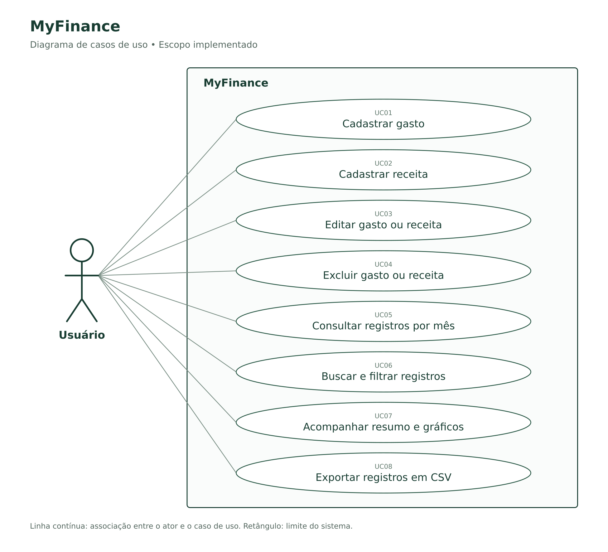

# MyFinance — levantamento de requisitos e casos de uso

**Versão da documentação:** 1.0 — 15/10/2026  
**Base analisada:** código do projeto MyFinance, commit `b232f772e8974b5f2c7bfba6d3c6266d54977065`.  
**Método:** levantamento a partir das solicitações registradas na conversa e da inspeção da implementação. Não foram realizadas entrevistas com outros usuários. Alterações posteriores feitas no GitHub não estão contempladas.

## 1. Objetivo e escopo

O MyFinance é um sistema web de acompanhamento financeiro mensal. Seu objetivo é permitir que o usuário registre gastos e receitas e compreenda como seu dinheiro está distribuído entre categorias.

O escopo atual compreende cadastro, consulta, edição e exclusão de registros, seleção do mês, indicadores financeiros, gráficos de despesas, busca, filtro por categoria e exportação CSV. A interface adota uma tela principal simplificada, com os registros em uma área recolhível.

Neste documento, **registro** significa um gasto ou uma receita. “Entradas” corresponde às receitas e “gastos” corresponde às despesas. O saldo apresentado é a diferença entre entradas e gastos do mês, e não um saldo bancário.

## 2. Ator e fronteira do sistema

| Ator | Responsabilidade |
| --- | --- |
| Usuário | Pessoa que registra e acompanha gastos e receitas, corrige dados, consulta indicadores e exporta registros. |

A fronteira do diagrama representa as funcionalidades do MyFinance. O banco de dados é um componente interno, não um ator. Na versão hospedada entregue, o acesso privado é controlado pela plataforma Sites; o MyFinance não implementa cadastro de contas, recuperação de senha ou autenticação própria.

**Pré-condição geral:** o usuário tem acesso ao site e o serviço está disponível. Os registros atuais não possuem identificação de proprietário por usuário; portanto, a aplicação documentada não é um sistema multiusuário com isolamento de dados.

## 3. Diagrama de casos de uso



As linhas representam associações entre o usuário e as funcionalidades; não representam uma sequência de execução. O diagrama não usa `include` ou `extend`: validação, confirmação de exclusão e recálculo são passos dos fluxos, e não objetivos independentes do usuário.

## 4. Requisitos funcionais

Os requisitos abaixo descrevem comportamentos identificados no código. **“Implementado” significa presente na implementação, não certificação de funcionamento em todos os cenários.** Os critérios de aceitação são verificações derivadas desses comportamentos e podem ser utilizados em testes futuros.

| ID | Requisito | Critério de aceitação | Caso de uso | Situação |
| --- | --- | --- | --- | --- |
| RF01 | Permitir cadastrar um gasto com descrição, valor, data, categoria, forma de pagamento e observações opcionais. | Ao salvar dados válidos, criar um registro do tipo gasto e atualizar os indicadores do mês da data informada. | UC01 | Implementado |
| RF02 | Permitir cadastrar uma receita com descrição, valor, data, categoria, forma de recebimento e observações opcionais. | Ao salvar dados válidos, criar um registro do tipo receita e contabilizá-lo nas entradas do mês. | UC02 | Implementado |
| RF03 | Permitir editar gastos e receitas existentes. | Abrir o formulário preenchido, salvar alterações no mesmo registro e atualizar os totais; permitir alterar inclusive tipo e data. | UC03 | Implementado |
| RF04 | Permitir excluir gastos e receitas mediante confirmação na interface. | Cancelar deve preservar o registro; confirmar com sucesso deve removê-lo da base e atualizar os totais e gráficos. | UC04 | Implementado |
| RF05 | Permitir navegar entre meses e consultar seus registros. | Ao mudar o mês, exibir somente registros cuja data pertença ao mês e ano selecionados, dentro dos dados carregados. | UC05 | Implementado |
| RF06 | Permitir buscar registros por descrição ou categoria, sem diferenciar maiúsculas de minúsculas. | Exibir, na lista do mês, os registros cujo texto da descrição ou categoria contenha o termo informado. | UC06 | Implementado |
| RF07 | Permitir filtrar a lista por categoria. | Exibir a categoria selecionada ou todas as categorias; combinar o filtro com a busca. | UC06 | Implementado |
| RF08 | Apresentar total de entradas, total de gastos e saldo do mês. | Calcular entradas e gastos separadamente; apresentar saldo igual a entradas menos gastos. | UC07 | Implementado |
| RF09 | Apresentar gráfico de distribuição das despesas por categoria. | Somar gastos por categoria e mostrar participação percentual no total de despesas do mês. Receitas não entram nesse gráfico. | UC07 | Implementado |
| RF10 | Apresentar as cinco categorias com maiores gastos. | Ordenar os totais de despesas por categoria de forma decrescente e mostrar até cinco categorias com barras e valores. | UC07 | Implementado |
| RF11 | Comparar as despesas com as do mês imediatamente anterior. | Havendo despesas anteriores maiores que zero, informar a variação percentual; caso contrário, omitir a comparação. | UC07 | Implementado |
| RF12 | Exportar os registros visíveis em CSV. | Baixar arquivo com data, tipo, descrição, categoria, pagamento, valor e observações, respeitando mês, busca e categoria selecionados. | UC08 | Implementado |
| RF13 | Informar erros de validação ou falhas nas operações. | Dados inválidos devem impedir o salvamento; falhas de edição/exclusão devem apresentar mensagem em vez de informar sucesso. | UC01–UC04 | Implementado, com limitações de validação descritas na seção 10 |

## 5. Requisitos não funcionais e restrições

| ID | Requisito ou restrição | Evidência / situação |
| --- | --- | --- |
| RNF01 | Apresentar interface em português e valores em reais. | Rótulos em português e formatação `pt-BR`/`BRL` no código. |
| RNF02 | Organizar a interface de forma simples e adaptável à largura da tela. | Layout responsivo, três indicadores principais, dois gráficos e lista recolhível. A facilidade de uso e a compatibilidade entre navegadores ainda requerem testes com usuários/dispositivos. |
| RNF03 | Persistir registros no servidor para permitir consultas posteriores. | Uso de Cloudflare D1 com acesso por Drizzle. Os dados não dependem apenas do armazenamento do navegador. Não há política de backup implementada no código da aplicação. |
| RNF04 | Representar valores financeiros em centavos inteiros. | Campo `amount_cents` e conversão da entrada monetária antes do envio à API. |
| RNF05 | Organizar o código de modo a permitir manutenção e testes. | Interface, API, esquema do banco e utilitário monetário separados; migração SQL e testes automatizados incluídos. |
| RNF06 | Fornecer identificação das ações e feedback ao usuário. | Botões “Editar” e “Excluir”, rótulos de formulário, foco visível e confirmação de exclusão com componente de diálogo. Não representa declaração de conformidade integral com WCAG. |
| RT01 | Executar em ambiente compatível com a arquitetura atual. | React/TypeScript, Vinext/Vite, Cloudflare Workers, D1 e Drizzle; o banco é necessário para consulta e alteração de registros. |
| RT02 | Restringir o acesso na implantação privada entregue. | A restrição é fornecida pelo Sites, não por autenticação própria nas rotas. Outra hospedagem exige configuração equivalente. |

Não foram definidos ou medidos SLA, tempo máximo de resposta, volume de usuários simultâneos ou capacidade máxima de armazenamento. Esses números não devem ser apresentados como garantias do projeto.

## 6. Regras de negócio

| ID | Regra |
| --- | --- |
| RN01 | Cada registro pertence a um único tipo: gasto (`expense`) ou receita (`income`). |
| RN02 | O valor informado deve ser maior que zero e representável em centavos inteiros. Na interface, são aceitos formatos como `150,50`, `150.50` e `1.500,50`. |
| RN03 | Descrição, valor, data, categoria e tipo compõem o registro. A interface também atribui uma forma de pagamento/recebimento. Observações são opcionais. |
| RN04 | O mês de competência usado pelo painel é obtido da data informada no registro. |
| RN05 | Saldo mensal = soma das receitas do mês − soma dos gastos do mês. Não há transporte automático do saldo de meses anteriores. |
| RN06 | Os gráficos de categorias consideram somente gastos do mês selecionado. |
| RN07 | Participação da categoria = gastos da categoria ÷ gastos totais do mês × 100. A legenda arredonda os percentuais para números inteiros. |
| RN08 | Variação mensal = (gastos do mês selecionado − gastos do mês anterior) ÷ gastos do mês anterior × 100. A comparação só aparece quando o denominador é maior que zero. |
| RN09 | A busca e o filtro por categoria afetam a lista de registros e a exportação CSV. Não alteram os totais e gráficos do mês. |
| RN10 | A exclusão definitiva requer confirmação na interface. Não existe lixeira ou ação de desfazer. |
| RN11 | Após salvar, a interface seleciona o mês da data do registro. Edição e exclusão bem-sucedidas recalculam os indicadores com os dados presentes na tela. |
| RN12 | A forma de pagamento/recebimento é apenas uma classificação. Selecionar cartão de crédito não cria parcelas, faturas ou pagamentos automáticos. |
| RN13 | O CSV utiliza ponto e vírgula como separador, UTF-8 com BOM e vírgula decimal nos valores. A exportação fica desabilitada quando não há registros visíveis. |

### Opções existentes na interface

- **Categorias de gastos:** Alimentação, Moradia, Transporte, Saúde, Educação, Lazer, Compras, Assinaturas e Outros.
- **Categorias de receitas:** Salário, Freelance, Investimentos, Reembolso e Outras receitas.
- **Formas de pagamento/recebimento:** Pix, Cartão de crédito, Cartão de débito, Dinheiro, Boleto, Transferência e Outros.

As categorias são predefinidas no código. O usuário não pode criar categorias pela interface.

## 7. Especificação dos casos de uso

### UC01 — Cadastrar gasto

**Ator:** Usuário. **Requisitos:** RF01, RF13.  
**Pré-condição:** acesso ao sistema e formulário disponível.

1. O usuário seleciona “Adicionar gasto”.
2. Mantém o tipo “Gasto” e informa descrição, valor, data, categoria, pagamento e, opcionalmente, observações.
3. Seleciona “Salvar”.
4. O sistema valida os dados, solicita a gravação e aguarda a resposta do servidor.
5. Após sucesso, apresenta o mês do registro e atualiza os indicadores.

**Alternativas:** cancelar fecha o formulário sem gravar; dados inválidos ou falha no salvamento geram mensagem.  
**Pós-condição:** gasto persistido após confirmação de sucesso da API.

### UC02 — Cadastrar receita

**Ator:** Usuário. **Requisitos:** RF02, RF13.  
**Pré-condição:** acesso ao sistema.

1. O usuário abre o formulário pelo botão “Adicionar gasto”.
2. Troca o tipo para “Receita”.
3. Informa origem/descrição, valor, data, categoria, forma de recebimento e observações opcionais.
4. Seleciona “Salvar”.
5. O sistema valida, persiste a receita e atualiza as entradas e o saldo do mês correspondente.

**Alternativas:** cancelar não grava; dados inválidos ou falha no salvamento geram mensagem.  
**Pós-condição:** receita persistida. O ponto de entrada pelo botão “Adicionar gasto” é uma característica da interface atual.

### UC03 — Editar gasto ou receita

**Ator:** Usuário. **Requisitos:** RF03, RF13.  
**Pré-condição:** registro existente e acessível na lista do mês.

1. O usuário abre “Ver gastos e receitas do mês”.
2. Seleciona “Editar” ao lado do registro.
3. O sistema carrega os campos existentes no formulário.
4. O usuário altera os dados e seleciona “Salvar alterações”.
5. O sistema valida e atualiza o registro mantendo seu identificador.
6. A interface passa ao mês da data salva e recalcula os indicadores.

**Alternativas:** cancelar não persiste as alterações; dados inválidos, registro inexistente ou falha do servidor geram mensagem.  
**Pós-condição:** alterações persistidas após sucesso; mudança de tipo pode transferir o valor entre receitas e gastos.

### UC04 — Excluir gasto ou receita

**Ator:** Usuário. **Requisitos:** RF04, RF13.  
**Pré-condição:** registro existente e acessível na lista do mês.

1. O usuário seleciona “Excluir” ao lado do registro.
2. O sistema apresenta uma confirmação dentro da página, com descrição e valor.
3. O usuário seleciona “Confirmar exclusão”.
4. O sistema solicita a exclusão ao servidor e impede nova confirmação enquanto processa.
5. Após sucesso, remove o registro da tela e atualiza indicadores e gráficos.

**Alternativas:** “Cancelar” preserva o registro; falha ou registro não encontrado gera mensagem.  
**Pós-condição:** registro removido definitivamente após sucesso da API.

### UC05 — Consultar registros por mês

**Ator:** Usuário. **Requisito:** RF05.  
**Pré-condição:** dados carregados ou carregamento em andamento.

1. O usuário navega pelos botões de mês anterior ou seguinte.
2. O sistema seleciona o mês e o ano correspondentes.
3. O usuário expande a área de registros.
4. O sistema apresenta gastos e receitas daquele mês, dentro do conjunto carregado.

**Alternativas:** mês sem registros mostra estado vazio; falha de carregamento apresenta mensagem.  
**Pós-condição:** mês selecionado disponível para consulta. Há limite de carregamento descrito na seção 10.

### UC06 — Buscar e filtrar registros

**Ator:** Usuário. **Requisitos:** RF06, RF07.  
**Pré-condição:** área de registros aberta.

1. O usuário digita um termo de busca e/ou seleciona uma categoria.
2. O sistema aplica as condições aos registros do mês selecionado.
3. A lista e a contagem são atualizadas.

**Alternativas:** limpar a busca e selecionar todas as categorias remove essas restrições; nenhum resultado produz uma lista vazia.  
**Pós-condição:** lista filtrada; indicadores e gráficos continuam representando o mês completo dentro dos dados carregados.

### UC07 — Acompanhar resumo e gráficos

**Ator:** Usuário. **Requisitos:** RF08–RF11.  
**Pré-condição:** mês selecionado e dados carregados.

1. O usuário consulta entradas, gastos e saldo do mês.
2. Consulta a distribuição das despesas por categoria e o ranking das cinco maiores categorias.
3. Quando disponível, consulta a variação em relação ao mês anterior.

**Alternativas:** sem gastos, o sistema apresenta estados vazios nos gráficos; sem gastos no mês anterior, não apresenta variação percentual.  
**Pós-condição:** usuário visualiza o resumo financeiro calculado para o mês.

### UC08 — Exportar registros em CSV

**Ator:** Usuário. **Requisito:** RF12.  
**Pré-condição:** ao menos um registro visível na lista.

1. O usuário escolhe o mês e, se desejar, aplica busca e filtro por categoria.
2. Seleciona “Exportar CSV”.
3. O sistema gera e disponibiliza o download de `lancamentos-AAAA-MM.csv` com os registros visíveis.

**Alternativa:** sem registros visíveis, o botão fica desabilitado.  
**Pós-condição:** arquivo disponibilizado para download pelo navegador; os dados do sistema não são alterados.

## 8. Dados do registro

| Campo técnico | Significado | Representação |
| --- | --- | --- |
| `id` | Identificador do registro | Inteiro, chave primária autoincremental |
| `description` | Descrição do gasto ou origem da receita | Texto |
| `amount_cents` | Valor financeiro | Inteiro em centavos |
| `type` | Gasto ou receita | Texto (`expense` ou `income` na aplicação) |
| `category` | Categoria | Texto |
| `payment_method` | Forma de pagamento/recebimento | Texto |
| `transaction_date` | Data atribuída pelo usuário | Texto no formato `AAAA-MM-DD` |
| `notes` | Observações opcionais | Texto, vazio por padrão |
| `created_at` | Momento de criação do registro | Texto com valor padrão `CURRENT_TIMESTAMP` |

## 9. Rastreabilidade técnica

| Elemento | Arquivo / operação |
| --- | --- |
| Interface e regras do painel | `app/page.tsx` |
| Estilos e identidade | `app/globals.css`, `app/layout.tsx`, `public/myfinance-logo.svg` |
| Listar registros | `GET /api/transactions` — `app/api/transactions/route.ts` |
| Criar gasto ou receita | `POST /api/transactions` — `app/api/transactions/route.ts` |
| Editar registro | `PUT /api/transactions/:id` — `app/api/transactions/[id]/route.ts` |
| Excluir registro | `DELETE /api/transactions/:id` — `app/api/transactions/[id]/route.ts` |
| Persistência e esquema | `db/index.ts`, `db/schema.ts` |
| Migração inicial | `drizzle/0000_organic_whistler.sql` |
| Conversão monetária | `lib/money.ts` |
| Testes de lógica | `tests/transactions.test.cjs` |

## 10. Limitações identificadas na versão documentada

1. **Limite de consulta:** a API retorna até 2.500 registros, ordenados por data e identificador decrescentes. Não há paginação. Totais, gráficos e exportações usam o conjunto carregado; após ultrapassar esse limite, meses antigos podem ficar incompletos.
2. **Validação parcial no servidor:** a API confere campos básicos e o formato textual da data, mas não valida integralmente a existência da data no calendário, as listas permitidas de categorias/pagamentos ou a combinação entre tipo e categoria. Tipos diferentes de `income` são tratados como gasto pela API.
3. **Validação monetária desigual nas rotas:** a interface exige inteiro seguro em centavos; a criação usa `Number.isInteger` e a edição usa `Number.isSafeInteger` no servidor.
4. **Acesso e propriedade:** não há autenticação própria nem separação dos registros por usuário. A proteção privada da implantação entregue depende da plataforma.
5. **Sem sincronização automática entre sessões:** alterações feitas em outra aba ou dispositivo exigem novo carregamento para aparecerem. Não há tratamento de conflitos de edição simultânea.
6. **Ordenação após alterações:** a API ordena os registros na consulta, mas a lista local não é reordenada integralmente após toda criação/edição; recarregar consulta novamente a ordem do servidor.
7. **Exportação:** CSV corresponde aos registros visíveis, e não necessariamente a toda a base. Não há importação de arquivos. Textos exportados não recebem tratamento específico contra fórmulas de planilhas.
8. **Testes:** existem testes de lógica com armazenamento simulado. A verificação de interação completa em navegador, acessibilidade, desempenho e persistência entre dispositivos não foi concluída nesta documentação.

Esses pontos descrevem limites observados; não são funcionalidades concluídas nem compromissos aprovados de evolução.

## 11. Fora do escopo atual

Não estão implementados: metas financeiras, orçamento por categoria, parcelamento, despesas recorrentes automáticas, faturas de cartão, integração bancária, importação CSV/Excel, recuperação de registros excluídos, notificações, relatórios anuais específicos e contas independentes para múltiplos usuários.

## 12. Uso desta documentação no repositório

Copie esta pasta para `docs/` no GitHub. O documento já referencia `casos-de-uso.png` por caminho relativo. Para inserir o diagrama no README da raiz:

```markdown


[Levantamento de requisitos](docs/REQUISITOS.md)
```

O arquivo `casos-de-uso.svg` preserva a imagem vetorial. O arquivo `casos-de-uso.puml` contém a definição editável em PlantUML; a disposição visual pode variar conforme o renderizador.
